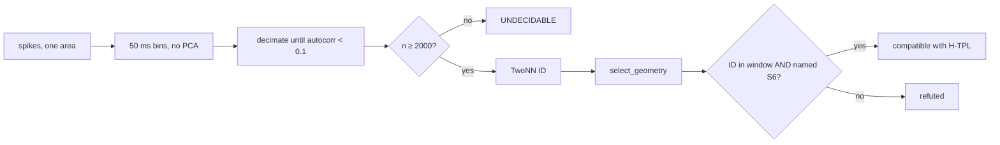

# TPL-Lab — a falsification lab for a geometric theory of perception

[](https://github.com/AxelNoun/tpl-lab/actions/workflows/tests.yml)
[](LICENSE)

**Documentation détaillée en français :** [`docs/`](docs/README.md) · **English README below.**

This repository does **not** try to prove that consciousness has an octonionic
geometry. It turns a speculative Substack conjecture (VSA-TOE / “Topological
Phase-Locking”) into a **pre-registered, runnable test**, then runs that test
on public Neuropixels recordings. A clean negative result is a success of the
lab.

**Headline (frozen rule, two mice).** On the longest continuous *spontaneous*
block of Allen Visual Coding Neuropixels, population spike-count clouds in
visual cortex are **not** compatible with S⁶. **12 / 12** area × session pairs
are refuted. That also knocks down the stronger claim about a sustained
percept: if the manifold is already absent with no controlled stimulus, the
perceptual version does not survive on this observable.

Raw NWB files and `.npy` extracts are **not** in git (several GB). Commands
below re-download them from the Allen Institute.

---

## Contents

1. [What was claimed](#what-was-claimed)
2. [What we actually test](#what-we-actually-test)
3. [Concepts](#concepts)
4. [The frozen decision rule](#the-frozen-decision-rule)
5. [How the work was done](#how-the-work-was-done)
6. [Empirical results](#empirical-results)
7. [Quick start](#quick-start)
8. [Reproduce the Allen tests](#reproduce-the-allen-tests)
9. [Workstreams](#workstreams)
10. [What this does not show](#what-this-does-not-show)

---

## What was claimed

The source text (a blog essay, **not** a paper) suggested that during a
sustained percept, cortical population dynamics would be confined to a
low-dimensional manifold inherited from exceptional geometry:

- the octonions \(\mathbb{O}\) have automorphism group **G₂** (dimension 14);
- the stabilizer of a point is **SU(3)** (dimension 8);
- the homogeneous space is **G₂ / SU(3) ≅ S⁶**, the 6-sphere in \(\mathbb{R}^7\).

If that geometry constrained the neural state, the **intrinsic dimension** of
the population cloud should saturate at **6** (or 8), not 7, not 11, not “about
20”. That integer is the one rigid, pre-stateable number in the story.

The original essay also offered a “phase triplet closure” signature. It is
either an algebraic tautology or something a generic Kuramoto model already
produces. It does **not** test octonionic non-associativity. See
[`docs/03-critique-tests-originaux.md`](docs/03-critique-tests-originaux.md)
and `python -m tpl.demo --seed 42`.

---

## What we actually test

After writing a **bridge law** (what a “point of the manifold” is in the
recording), most of the TOE is not estimable from a passive trajectory:

| Claim | Status |
|---|---|
| Intrinsic dimension in \([5.5, 6.5)\) or \([7.5, 8.5)\) | Testable — TwoNN |
| Geometry **named S⁶**, not T⁶, not R⁶, not “none” | Testable — fingerprint + cutoff |
| Collapse under anesthesia | Testable **if** a spike dataset has both states (Allen does not) |
| Persistent \(b_1 = 0\) | Non-discriminating for \(d \ge 3\) at \(n \le 3000\) |
| G₂ spectral multiplets \(1/7, 2/63, 1/63\) | Statement about S⁶ ⊂ ℝ⁷; **PCA to 7 is forbidden** |
| An SU(3) *action* | Not a prediction (an action is a family of maps, not one path) |
| Octonion product / non-associativity | Needs causal perturbations (TMS / optogenetics) |
| Constant percept \(> 10\) s | **Underpowered** on public Neuropixels (10 s = 200 bins; we need ≥ 2000 after decorrelation) |

So the empirical hypothesis is narrower than the blog:

> **H-TPL:** spike-count vectors of **one** cortical area, 50 ms non-overlapping
> windows, no PCA, no z-score, thinned until mean autocorrelation \(< 0.1\),
> \(n \ge 2000\), have TwoNN ID in a predicted window **and**
> `select_geometry` names **S6** with score \(\le 3.0\).

The first test we could actually power on public data is weaker still:

> **H1-spontaneous:** the same two measures, on the longest continuous
> `spontaneous` block of one visual area, awake, **no controlled percept**.

Compatible there would not license talk of perception. A miss there also misses
H1. We got a miss.

---

## Concepts

**Intrinsic dimension (TwoNN).** Facco et al. (2017): from the ratio of
distances to the first and second nearest neighbours one regresses a dimension
\(\hat{d}\). Temporally correlated samples bias \(\hat{d}\) **down** (which
would fake a “d = 6”). The pipeline therefore **decimates** until
autocorrelation \(< 0.1\), then refuses to conclude if fewer than 2000 points
remain (on a true S⁶, false-refute is 14 % at \(n = 1000\) and 1 % at 2000).

**S⁶ vs T⁶ vs R⁶.** Strong inference, not “is TPL true?”. A 6-torus (grid-cell
style) or Euclidean 6-space that *fits* is a **rival**, not a confirmation.
Ranking always names a winner (base rate 1/3). `select_geometry` accepts the
winner only if the score \(\le 3.0\) (calibrated on synthetic data **before**
real recordings). R⁶ sits in the d = 6 ID window 100 % of the time — the old
rule “any fitted 6-D candidate” would have confirmed TPL on isotropic noise.

**Nulls.** A signature that Kuramoto, phase-randomized surrogates
(`preserve_cross=True`), or a chaotic RNN already produce is
non-discriminating. Measure 1 alone does not beat a 12-oscillator Kuramoto
(ID = 8.23, inside the d = 8 window). Measure 2 does.

**Octonions / G₂ / SU(3).** Implemented and tested (`tests/test_g2.py`):
\(\dim \mathfrak{g}_2 = 14\), \(\dim \mathfrak{su}(3) = 8\). These are
mathematical facts, not neural evidence. The S⁶ covariance spectrum in the
raw embedding is four exact levels \(1/7, 2/63, 1/63, 0\) — never a “plateau
of 27” in the non-orthonormal basis.

**Bridge law.** A point is a population spike-count vector in \(\mathbb{R}^N\)
(\(N \ge 7\)), not a point of S⁶ ⊂ ℝ⁷. PCA, per-channel z-score, square-root
transforms, firing-rate cuts, and pooling several areas are refused in code
(`tpl.analysis.bridge`). TwoNN is not invariant to anisotropic rescaling:
z-scoring would sphericalize the cloud toward S⁶.



---

## The frozen decision rule

Locked in [`PREREGISTRATION.md`](PREREGISTRATION.md) and tag **`prereg-v1`**
(`0a5e794`, 20 Aug 2026) **before** contact with real spikes. Thresholds,
windows, and the named-S6 rule do not move after that tag.

| TwoNN ID | Verdict |
|---|---|
| \(< 5.5\) | refuted — too low |
| \([5.5, 6.5)\) | compatible with \(d = 6\) |
| \([6.5, 7.5)\) | refuted — between the two integers |
| \([7.5, 8.5)\) | compatible with \(d = 8\) |
| \(\ge 8.5\) | refuted — too high |
| \(n < 2000\) after lag, or never-decorrelating series | **UNDECIDABLE** — no estimate published |

H1 requires measure 1 **and** geometry `== "S6"`. A fitted T6 or R6 refutes
TPL. None of the three also refutes.

Replay the frozen plan on synthetic data:

```bash
git checkout prereg-v1
python -m tpl.analysis.run_id --config configs/prereg_v1.json --synthetic --seed 42
```

---

## How the work was done

1. **Scaffold** — 12 workstreams, English code / French `docs/`, pytest, `--seed` everywhere, `synth_` prefix for simulations.
2. **Independent audit** — algebra held (octonions, \(\mathfrak{g}_2\), spectrum). Statistics did not: bootstrap-with-replacement inflated TwoNN; fingerprints mixed scale; ranking could not say “none of these”. Fixes and negatives are in [`docs/RESULTATS_NEGATIFS.md`](docs/RESULTATS_NEGATIFS.md).
3. **Calibration on synthetic data only** — false-refute curve, TPR/TNR, noise, CI coverage. Then **freeze**.
4. **Loader that cannot cheat duration** — longest *single* stimulus block, never the sum of 2 s gratings. Blocks \(< 100\) s are refused.
5. **H1-spontaneous** — session `767871931`, VISp, declared first test ([`docs/14-h1-spontane.md`](docs/14-h1-spontane.md)).
6. **Same block, other visual areas** — family written down *before* looking ([`docs/15-aires-supplementaires.md`](docs/15-aires-supplementaires.md)).
7. **Other mouse** — first `functional_connectivity` session in the public table that was not the first animal, declared before the NWB download ([`docs/16-replication-session.md`](docs/16-replication-session.md)).

No threshold was tuned after seeing spikes. Other Allen sessions are not a
rescue protocol.

---

## Empirical results

Allen Visual Coding, awake only. Longest `spontaneous` block \(\approx 30\) min
(six blocks exist; **sum unused**). Isolation: SDK `quality == good` only.
Seed 42. Pipeline: `python -m tpl.analysis.run_id --config configs/prereg_v1.json`.

### Session 767871931 (specimen 753795610)

| Area | Independent \(n\) | ID | Geometry (score) | H1 |
|---|---|---|---|---|
| VISp (declared test) | 7210 | 37.07 | none (R6 41.68) | refuted |
| VISal | 6009 | 26.87 | none (T6 29.92) | refuted |
| VISam | 5150 | 24.42 | none (T6 28.01) | refuted |
| VISpm | 36050 | 32.77 | none (T6 35.35) | refuted |
| VISrl | 6009 | 26.54 | none (T6 29.61) | refuted |
| VISli | 7210 | 26.82 | none (T6 28.70) | refuted |
| phase surrogate of VISp | 7210 | 42.85 | none (R6 63.32) | refuted |

### Session 766640955 (specimen 744912849) — replication

| Area | Independent \(n\) | ID | Geometry (score) | H1 |
|---|---|---|---|---|
| VISp | 18025 | 23.61 | none (**S6** 26.75) | refuted |
| VISal | 9013 | 28.73 | none (R6 32.42) | refuted |
| VISam | 9013 | 29.24 | none (T6 32.59) | refuted |
| VISl | 9013 | 20.97 | none (R6 24.55) | refuted |
| VISrl | 6009 | 21.77 | none (**S6** 25.50) | refuted |
| VISmma | 36050 | 29.85 | none (T6 32.36) | refuted |

**12 / 12 refuted.** Twice S⁶ *wins the ranking* with score \(\sim 26\)
(\(\approx 9\times\) the cutoff). `rank_candidates` alone would have lied;
`select_geometry` refuses. Autocorrelation biases TwoNN downward, so a lag
that was “too small” cannot manufacture ID \(\approx 25\)–\(37\).

---

## Quick start

Python ≥ 3.11. Core deps: numpy, scipy, ripser.

```bash
git clone https://github.com/AxelNoun/tpl-lab.git
cd tpl-lab
pip install -e ".[dev]"
pytest -q
python -m tpl.demo --seed 42
python -m tpl.analysis.run_id --config configs/prereg_v1.json --synthetic --seed 42
```

Optional: `pip install -e ".[nwb]"` for the HDF5 reader (`h5py`). The full
Allen SDK extra (`".[full]"`) wants Python 3.11 and is not required if you
pass `--nwb` to `python -m tpl.io.allen`.

---

## Reproduce the Allen tests

Data stay in `data/` (gitignored). Example for the declared first session:

```bash
# ~2.6 GB from the Allen Institute
curl.exe -L -o data/allen/session_767871931/session_767871931.nwb \
  "http://api.brain-map.org/api/v2/well_known_file_download/1026124194"

pip install -e ".[nwb]"
python -m tpl.io.allen --nwb data/allen/session_767871931/session_767871931.nwb --list
python -m tpl.io.allen --nwb data/allen/session_767871931/session_767871931.nwb \
    --area VISp --stimulus spontaneous --out data/real_VISp.npy
python -m tpl.analysis.run_id --config configs/prereg_v1.json \
    --data data/real_VISp.npy --seed 42
```

Well-known file for the replication session: `1026124293`
(`ecephys_session_766640955.nwb`). Full commands: docs 14–16.

---

## Workstreams

| # | Topic | Status |
|---|--------|--------|
| 1 | Local hypothesis (cut the TOE down to what is testable) | Done — [`docs/01`](docs/01-hypothese.md) |
| 2 | Bridge law | Done — PCA to 7 frozen OFF |
| 3 | Generative S⁶ / su(3) flow | Tool — pure holonomy is not a passive test |
| 4 | Nulls (Kuramoto, surrogates, chaotic RNN) | Done |
| 5 | Non-associativity | Protocol only — needs a lab |
| 6 | ID = 6 or 8 | **H1-spontaneous refuted 12/12** (Allen). IBL VISp INDECIDABLE (spontaneous and full session) |
| 7 | Preregistration | Frozen `prereg-v1` |
| 8 | Structural psychophysics | Protocol only |
| 9 | Geometry ranking | Synthetic acc 1.0; mGPLVM still a TODO |
| 10 | G₂ multiplets | Exact on S⁶ ⊂ ℝ⁷; not applicable to N-channel data |
| 11 | Wake vs anesthesia | Tool ready; no public spike set wired |
| 12 | Power / calibration | TPR, noise, CI coverage measured |

Open, if someone continues: a wake/anesthesia *spike* corpus (IBL at 50 ms
is not decorrelatable under the frozen 0.1 autocorrelation rule; docs/18–19),
structured low-rank RNN (independent \(U,V\) and \(UU^\top\) were tried and
discarded).

---

## What this does not show

- It does not show that “cortex has no manifold” in general.
- It does not test a 10 s percept (underpowered; concatenation forbidden).
- IBL 10 min spontaneous **and** the 97 min continuous session are
  INDECIDABLE (docs/18–19). Autocorrelation never fell below 0.1.
- It does not test anesthesia or causal non-associativity.
- Compatible / refuted \(\neq\) “proves that”. Vocabulary in `CLAUDE.md`.

Scientific rules (non-negotiable): every confirmatory signature must beat a
null; no HARKing on thresholds; simulated artefacts prefixed `synth_`;
`--seed` on every script; negatives kept in
[`docs/RESULTATS_NEGATIFS.md`](docs/RESULTATS_NEGATIFS.md).

---

## Citation

See [`CITATION.cff`](CITATION.cff). Please cite the repository and the
`prereg-v1` commit hash if you reuse the decision rule. Allen data: Siegle
et al., *Nature* (2021), Visual Coding Neuropixels.

Onboarding (French, free resources): [`docs/onboarding/PARCOURS.md`](docs/onboarding/PARCOURS.md).

## License

MIT. A clean negative is worth more than a soft confirmation.
